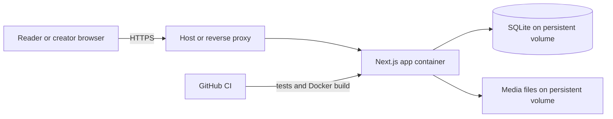

# Storytelling Prototype Architecture

## Summary

Build a responsive story library and creator publishing flow as a **single-instance, self-hosted Docker app**. The Next.js App Router app, SQLite database, local username/password authentication, and uploaded media run on one Docker host; the database and media live on a persistent mounted volume. The app has no external runtime identity dependency. HTTPS must terminate at the host or a reverse proxy when the app is reachable over the internet.

This smaller prototype replaces the earlier Vercel + Supabase service architecture. It is designed for a low-traffic demonstration, not horizontal scaling or high availability.

## Architecture and interfaces

- **App and runtime:** Use Next.js App Router with TypeScript in one Node.js 24 LTS container, pinning the patch image and lockfile versions. Node 24 is the current LTS line. [Node.js releases](https://nodejs.org/en/about/previous-releases) Public library/detail pages render on the server; client components handle filters, media controls, and uploads. Server Actions handle story edits, publication, and reports. Route Handlers stream uploads and serve media only after checking story visibility. Validate inputs and authorization at each server entry point.
- **Authentication:** Use Better Auth with its SQLite adapter and recommended `better-sqlite3` driver, email/password authenticator, and username plugin. The login form uses only username and password; signup asks for username, a private email address, display name, and password because the plugin requires email. Email is unverified and is not used for messaging in v1. Disable automatic sign-in after signup and return generic duplicate-account responses. Keep Better Auth's default scrypt password hashing. [Better Auth username plugin](https://better-auth.com/docs/plugins/username) · [Email/password authentication](https://better-auth.com/docs/authentication/email-password) · [SQLite adapter](https://better-auth.com/docs/adapters/sqlite)
- **Persistence:** Mount one named Docker volume at `/app/data`; store the SQLite database and media files there. Run a single app instance against this local volume. For a consistent application backup, stop the app to pause database writes and uploads, archive the closed database and media directory together, copy the archive off-host, then restart. SQLite WAL state must be included in any live backup. [SQLite WAL](https://www.sqlite.org/wal.html) Test restoring the archive before upgrades; include versioned DB migrations and run them before serving a new app image. This setup intentionally has no replicas, failover, or concurrent multi-host writes.
- **Data model:** `profiles` stores a public display name or pseudonym, separate from the private username and email used for sign-in. Omit account email and other private auth fields from every public DTO, story page, search result, and log; test this explicitly. `works` are stable creator-owned stories. `story_versions` store BCP-47 language, format, body or media reference, translator credit, translation/review metadata, attribution, and an explicit license or custom permission. Enforce one version per work and language. The owner adds translations and edits the current version in place for v1. Each version must explicitly select one of the six Creative Commons Attribution 4.0 International licenses (CC BY, CC BY-SA, CC BY-ND, CC BY-NC, CC BY-NC-SA, or CC BY-NC-ND) or provide a custom permission statement; do not preselect or inherit terms. Link to the full license deed or display the custom statement.
- **Media:** Support text, JPEG/PNG/WebP, MP3/WAV, MP4/WebM, and PDF, up to **40 MiB per file**. Accept only these file types; store files under generated IDs, never user-provided paths. Stream uploads into an unserved temporary directory, count bytes independently of request headers, reserve quota and temporary disk space before and during upload, validate type and size, then atomically move the file and save metadata in SQLite. Limit each account to 20 media files or 200 MiB total, whichever comes first; cap aggregate temporary uploads at 200 MiB and reserve 1 GiB of host disk for the app. Return clear errors when limits are reached. A failed/interrupted upload must be cleaned up and retried from the beginning in v1; remove stale temporary files and reservations on restart. Resumable uploads are deferred. Serve files through an app route that resolves only generated asset IDs, checks publication/ownership on every request, supports valid HTTP byte ranges for audio/video and returns 416 for invalid ranges, sends `Cache-Control: no-store`, `X-Content-Type-Options: nosniff`, and safe content headers, and downloads PDFs as attachments.
- **Routes and behavior:** `/stories` supports URL-backed `q`, `language`, and `format` filters; `/stories/[slug]?lang=…` shows a selected version and source relationship. Story-list and detail reads are dynamically rendered with database reads set to `no-store`, so a publish/unpublish change takes effect on the next request. Creator routes live under `/dashboard/stories`, with `/sign-in` and `/sign-up` for accounts. Readers browse anonymously; signed-in readers can submit private reports.
- **Moderation and operations:** Store reports in SQLite. No in-app admin UI in v1; provide host-only CLI commands inside the app container to list reports, create/reset/disable accounts, and unpublish a version. A reset command uses a no-echo prompt, never accepts or logs a password argument, uses the auth library's password hashing, and revokes existing sessions. Provide a signed-in change-password flow that revokes other sessions. Email is unverified and cannot prove ownership; forgotten-password recovery requires contacting the named maintainer through an independently known out-of-band channel. Reset only when the maintainer can verify the person by that channel; otherwise the account is unrecoverable in v1. Enable database-backed auth rate limits (5 username sign-ins per IP per minute; 3 signups per IP per hour), rate-limit reports to 5 per account per hour, disable username-availability lookup, and use generic login/signup errors. Better Auth supports database-backed limits and per-route rules. [Better Auth rate limiting](https://better-auth.com/docs/concepts/rate-limit) Trust client-IP headers only from the configured proxy. Keep logs free of passwords, session tokens, private account email, and private story content.
- **Deployment:** Build and run the app with Docker Compose on one self-hosted machine. Bind the app port only to the reverse-proxy network; use a host-managed TLS proxy or a small Caddy proxy container for public HTTPS. Next.js recommends a reverse proxy for self-hosting. [Next.js self-hosting](https://nextjs.org/docs/app/guides/self-hosting) Configure a canonical app URL, trusted origins, secure cookies, and trust forwarded headers only from the proxy. Keep `.env` secrets out of Git and `CODEX_LOG.md`. CI on each PR runs tests and builds the Docker image; deploy manually from `main` after a consistent backup. Do not use Vercel previews or production data in CI.

## TDD and acceptance

Use Vitest for unit tests and SQLite integration tests, plus Playwright for browser flows. Next.js recommends end-to-end coverage for async Server Components. [Next.js testing guidance](https://nextjs.org/docs/app/guides/testing) · [Playwright Test](https://playwright.dev/docs/intro)

- Write failing tests first for story/version relationships, explicit license requirements, file validation, and publication visibility.
- Verify the data access layer allows public reads only for published versions, allows owners to manage their own drafts, and denies cross-owner access. Test report visibility and the host-only unpublish command.
- Exercise username/password signup and login, invalid credentials, duplicate usernames, generic duplicate-signup responses, rate limits, account email omitted from all public DTOs/pages/search/logs, password change/reset and session revocation, browse/search/filter, version switching, upload size/type/quota boundaries, concurrent reservations, interrupted and disk-full uploads, signed-in reports, and media access after unpublishing. Test valid audio/video `Range` requests return `206`, invalid ranges return `416`, drafts reject readers, and no cached story or media response remains after unpublishing in a production build. Use seeded test identities and no real user data.
- Verify consistent offline backup/restore and migration from a fixture database. Confirm upload cleanup after simulated failures and app restart, path traversal/symlink rejection, reverse-proxy-only access, and that host-only commands cannot be invoked through web routes.
- CI runs typecheck, lint, unit/integration tests against temporary SQLite data, Playwright, and a Docker image build. Continue feature branches, small commits, TDD, and automatic Codex review of every PR.

## Assumptions and limits

- English is the interface language; English and isiZulu sample stories are fixtures, not a commitment to a launch region or language policy.
- A version has one primary format: text in SQLite or one uploaded media file, with transcript/caption/alt-text fields where applicable. Documents mean PDF in v1.
- Username/password sign-in is local. The login form needs only username and password. Public signup also asks for a private, unverified email because Better Auth's username plugin requires one; v1 does not send email or provide email-based recovery. Do not use that email to verify account recovery. Public creator identity uses a separate chosen display name or pseudonym.
- Search uses SQLite queries for title, creator, description, language, and format; no dedicated search service.
- No automated translation, external translators, revision history, in-app moderation, horizontal scaling, managed backups, resumable uploads, or production-grade search in v1. The self-host operator is responsible for TLS, host security updates, disk capacity, off-host backups, and tested restores. Treat the deployment as a non-durable prototype until those operations are exercised.
