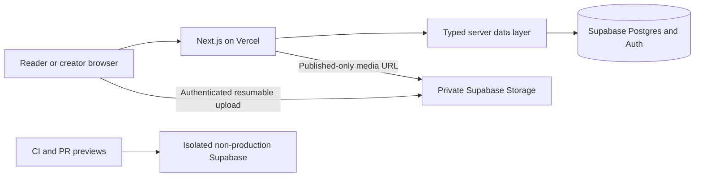

# Storytelling Platform Architecture

## Summary

Build a responsive web app for discovering and publishing stories, with language versions linked to their source. Use **Next.js App Router and TypeScript** on Vercel, with **Supabase Postgres, Google OAuth, and private Storage**. This reflects the selected direction: real creator accounts and uploads, owner-managed translations, self-publishing, and signed-in reporting.

The repository began with planning documents only. This architecture supersedes the earlier demo-only assumptions in `IDEA.md` that deferred accounts and durable storage.

## Architecture and interfaces

- **Next.js application:** Use server-rendered pages for public story discovery and detail; keep client components to interactive filters, media controls, and upload forms. Use server actions for create, edit, publish, and report operations. Treat every action as a public endpoint: validate inputs and authorize each operation. [Server and Client Components](https://nextjs.org/docs/app/getting-started/server-and-client-components) · [Authentication guidance](https://nextjs.org/docs/app/guides/authentication)
- **Supabase boundary:** Use cookie-based Google OAuth sessions and a server-only typed data access layer. Supabase's current SSR package is documented as beta; isolate and pin that integration, and test session refresh. [Supabase Next.js Auth quickstart](https://supabase.com/docs/guides/auth/quickstarts/nextjs) · [Supabase SSR guidance](https://supabase.com/docs/guides/auth/server-side)
- **Data model:** `profiles` holds a public display name or pseudonym, separate from private Google identity data. `works` represent stable stories owned by a creator. Each `story_version` has a BCP-47 language, content format, body or asset, translator credit, translation/review metadata, attribution, and an explicit license or custom permission. Enforce one version per work and language; the owner adds translations and edits the current version in place for v1. License terms are selected per version, never silently inherited.
- **Media:** Support text, JPEG/PNG/WebP, MP3/WAV, MP4/WebM, and PDF, with a **40 MiB maximum per file**. Upload directly from the browser to owner-scoped private Storage paths using resumable TUS uploads; store metadata in Postgres. Supabase recommends resumable uploads above 6 MB. [Resumable uploads](https://supabase.com/docs/guides/storage/uploads/resumable-uploads) · [Storage file limits](https://supabase.com/docs/guides/storage/uploads/file-limits) Public pages may receive short-lived signed URLs only for published versions; unpublishing blocks future URLs, while existing URLs may remain valid until expiry.
- **Reader and creator routes:** `/stories` supports URL-backed `q`, `language`, and `format` filters; `/stories/[slug]?lang=…` displays a selected version and its source relationship. Creator flows live under `/dashboard/stories`, including create and edit. Readers may browse anonymously; Google sign-in is required to publish or report.
- **Rights and reports:** Require an explicit version-level license or custom permission; do not imply that a license establishes consent or ownership. Store signed-in reports privately with a reason, optional detail, and status. A named maintainer investigates and unpublishes through the Supabase console; no in-app moderation UI in v1.
- **Deployment and data boundaries:** Use local Supabase for development, a separate seeded non-production Supabase project for CI and Vercel PR previews, and a separate production project for `main`. Never put production credentials or real user data in previews, tests, or `CODEX_LOG.md`. Keep authenticated, draft, and story pages uncached in v1 to avoid cross-user leakage and stale publication state. Supabase RLS must enforce published-only public reads and owner-only draft writes; never expose privileged keys to the browser. [Supabase RLS guidance](https://supabase.com/docs/guides/database/postgres/row-level-security) · [Vercel Next.js preview deployments](https://vercel.com/docs/frameworks/full-stack/nextjs)

## TDD and acceptance

Use Vitest for unit tests, Supabase local plus pgTAP for database/RLS tests, and Playwright for browser flows. Next.js recommends end-to-end coverage for async Server Components. [Next.js testing guidance](https://nextjs.org/docs/app/guides/testing) · [Playwright Test](https://playwright.dev/docs/intro)

- Write failing tests first for version relationships, license requirements, upload validation, and publication visibility.
- Verify RLS allows anonymous reads only for published versions, allows owners to manage their own drafts, and denies cross-owner access. Test Storage upload ownership and published-only reads.
- Exercise browse/search/filter, version switching, Google-authenticated publish, signed-in report submission, and maintainer unpublish behavior. Use seeded test identities; do not automate the live Google OAuth provider or use production data.
- CI runs typecheck, lint, unit/integration tests, pgTAP, and Playwright against isolated test data. Codex reviews each PR before merge; record meaningful tools, decisions, and evidence in `CODEX_LOG.md`.

## Assumptions

- English is the interface language; sample stories use English and isiZulu as fixtures, not a commitment to a launch region or language policy.
- A version has one primary format: text in Postgres or one uploaded media file, with transcript/caption/alt-text fields where applicable. Documents mean PDF in v1.
- Google-only sign-in is an accepted prototype constraint. Public creator identity uses a chosen display name or pseudonym, never the Google email.
- Search stays in Postgres for title, creator, description, language, and format. Automated translation, external translators, revision history, in-app moderation, and production-grade search remain out of v1.
